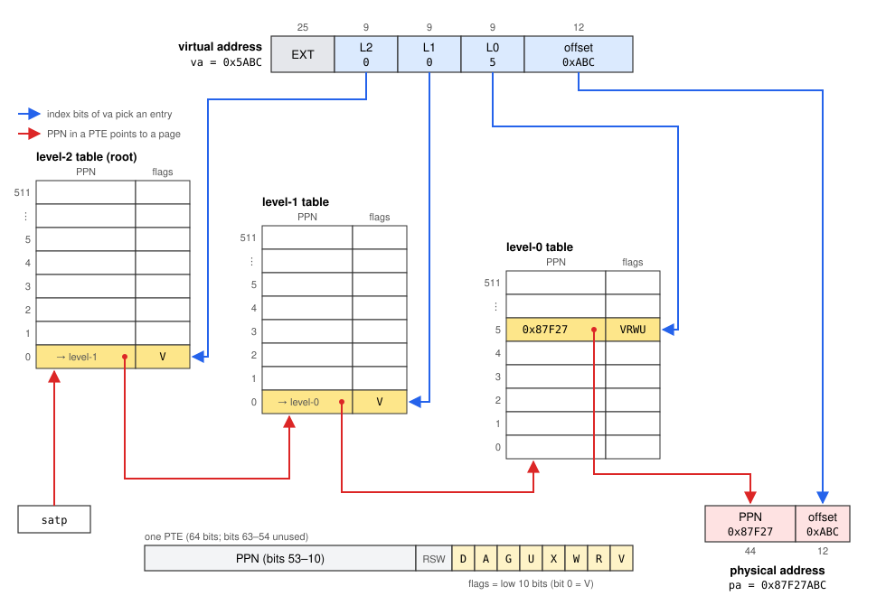

# xv6 Virtual Memory Lab

## A Journey Through Time (optional)

The Master Sword has awakened once again! With the recent release of The Legend of Zelda: Ocarina of Time on Nintendo Switch 2, let's return the legendary blade to its pedestal in the Temple of Time and travel back to 1998, when Link's adventure first began on the Nintendo 64.


In the original game, a young boy named Link sets out to save the kingdom of Hyrule from Ganondorf. When he draws the Master Sword from its pedestal in the Temple of Time, he is sealed away for seven years, awakening as an adult in a kingdom that has fallen into darkness. By returning the sword to its pedestal or drawing it again, Link can travel between his childhood and adulthood, using his actions across the two eras to change the course of his adventure.

But even the Hero of Time cannot simply undo every mistake. What if Link could capture a moment in his adventure and restore it whenever things went wrong?

Back in 1998, however, saving an adventure was no simple task. The Nintendo 64 had only **4 MB of RAM**, while *Ocarina of Time*'s cartridge provided just **32 KB of SRAM** for save data. Storing the entire contents of RAM in a save file was out of the question. Instead, the developers saved essential game state, such as Link's health, inventory, and quest progress, and reconstructed the rest when loading a save. The game also kept a backup copy of each of its three save slots to help protect against data loss.

Nearly three decades later, hardware is far more powerful, but saving state efficiently is still a challenge. Let's give Link a different kind of time-travel power: the ability to take a **snapshot of a region of memory** and restore it later.

This time, we are working inside an operating system. Unlike the game developers, the kernel does not know which memory contains rupees, weapons, or quest progress. The simplest solution would be to copy every page in the selected region whenever Link saves, but that would be wasteful. After all, collecting a few rupees or opening one treasure chest might change only a handful of pages.

Fortunately, RISC-V page-table entries contain a **dirty bit** that can indicate whether a page has been written to. The first checkpoint copies every page in the selected region. Later checkpoints can copy only pages modified since the previous checkpoint, and rollback can restore only the pages written since the latest one. That is the idea behind an **incremental snapshot**.

## Your Mission

Your mission is to bring this power to **xv6**. Along the way, you will translate virtual addresses into physical addresses, track modified pages, and control memory permissions. Finally, you will combine these concepts to implement an incremental checkpoint-and-rollback system.

Four problems, all in `kernel/vm.c`. Do them in order: q3 builds on q0 and q1.

| Problem | System call | Points |
| ------- | ----------- | ------ |
| q0 | `vatopa(va)`: virtual to physical address | 10 |
| q1 | `pgdirty(va, n, &mask)`: read and clear the dirty bits | 10 |
| q2 | `pgprotect(va, n, writable)`: make pages read-only or writable | 10 |
| q3 | `checkpoint(va, n)` / `rollback()`: incremental snapshot of a memory region | 70 |

## Trace Code

Lab quiz scope. No report.

- Address translation (`kernel/vm.c`, `kernel/riscv.h`):
  1. `walk()`: how `PX(level, va)` splits an address, what `PTE2PA` / `PA2PTE` do, why `walk()` can return 0 or a PTE without `PTE_V`.
  2. `mappages()`, `uvmalloc()`, `uvmunmap()`, `freewalk()`: how a page table is built and torn down.
- Growing the heap: `sbrk()` / `sbrklazy()` (`user/ulib.c`) -> `sys_sbrk()`. With `SBRK_EAGER`, `growproc()` -> `uvmalloc()` maps the pages at once. With `SBRK_LAZY`, only `sz` grows; a page fault (scause 13 / 15) -> `vmfault()` -> `mappages()` maps a page on its first access. When does `vmfault()` map a new page, and when does it refuse (address beyond `sz`, page already mapped)?

## Implementation

Fill in the six functions marked `TODO` at the end of `kernel/vm.c`. Everything else is already in place. The system calls are already wired up: `checkpoint()` calls `ckpt_take(p, va, n)`, `rollback()` calls `ckpt_rollback(p)`, and the others call the function of the same name with the process's page table first.

### Conventions

- **Range.** `va` must be page-aligned and `1 <= n <= 64` (`vmrange_ok()`); otherwise return `-1` and change nothing.
- **Mapped** = the PTE exists and has `PTE_V` and `PTE_U`. A lazy page that was never touched (`sbrklazy()`), the stack guard page, the trampoline and the trapframe are *not* mapped.
- **Flush the TLB** (`sfence_vma()`) after changing any PTE.

### q0: `uint64 vatopa(void *va)` (10 points)

The physical address of `va`, **page offset included**; `-1` if `va >= MAXVA` or the page is not mapped. Do not map anything: an untouched lazy page gives `-1`.

### q1: `int pgdirty(void *va, int n, uint64 *mask)` (10 points)

For the `n` pages at `va`: set bit `i` of `*mask` if page `i` has `PTE_D`, clear those bits, return how many were set. An unmapped page is clean, not an error.

```
user writes pages 1 and 3 of buf
pgdirty(buf, 4, &m)   -> 2, m = 0b1010
pgdirty(buf, 4, &m)   -> 0, m = 0        (cleared)
```

### q2: `int pgprotect(void *va, int n, int writable)` (10 points)

Clear `PTE_W` on the `n` pages at `va` (`writable == 0`) or set it (`writable != 0`); return 0. If any page is not mapped, return `-1` and change no page.

### q3: `checkpoint` / `rollback` (70 points)

An incremental snapshot of one region, kept by the kernel in a second page table, `p->shadow`, whose leaves point at copies of the pages. The region is the pages in `[va, va + n * PGSIZE)`; keep its start in `p->ckpt_va` and its page count in `p->ckpt_n`. One snapshot per process.

```
checkpoint(buf, 4)    -> 4   first call: every page copied
user writes pages 1 and 3
checkpoint(buf, 4)    -> 2   only pages 1 and 3 copied again
user writes page 0
rollback()            -> 1   page 0 restored
rollback()            -> 0   nothing written since
```

`int checkpoint(void *va, int n)`

- The whole region must be mapped; otherwise `-1` and change nothing.
- First call: create the shadow page table (`uvmcreate()`), copy every page, return `n`.
- Later calls: same region or `-1`; copy only the pages with `PTE_D`; return how many (0 if none).
- On success, clear `PTE_D` on the region and flush the TLB.
- Out of memory: free what was allocated, leave the process without a snapshot and its dirty bits unchanged, return `-1`.

`int rollback(void)`

- `-1` if there is no snapshot, or a page of the region is no longer mapped (the heap shrank).
- Copy back only the pages with `PTE_D`, clear `PTE_D` on them, flush the TLB, return how many.
- The dirty bit is the only record: a page cleared by `pgdirty()` is not restored.

`void ckpt_free(struct proc *p)`

- Free the copies and the shadow page table; reset the three fields. Called from `freeproc()` and `exec()`.
- A `fork()` child starts with `shadow == 0`: nothing to free.

## Hints

Background: chapter 3, "Page tables", of the [xv6 book](https://pdos.csail.mit.edu/6.1810/2025/xv6/book-riscv-rev5.pdf).

| Function / macro | What it does |
| ---------------- | ------------ |
| `walk(pt, va, alloc)` | pointer to the leaf PTE of `va`; `alloc=1` creates missing levels; 0 if a level is missing or `kalloc()` failed; panics if `va >= MAXVA` |
| `PTE2PA(pte)`, `PA2PTE(pa)` | PTE ↔ start of the physical page |
| `PGSIZE` | 4096, the page size |
| `uvmcreate()` | an empty page table |
| `uvmunmap(pt, va, n, do_free)` | zero `n` leaf PTEs, free their pages if `do_free`; skips unmapped pages |
| `freewalk(pt)` | free the page-table pages; panics if a leaf is still mapped |
| `kalloc()`, `kfree(pa)` | one physical page |
| `memmove(dst, src, n)` | copy bytes; physical addresses work in the kernel |
| `sfence_vma()` | flush the TLB |
| `pgdump(va, n)` (user) | print the PTEs of `n` pages, to see what your code did |

Flags: `PTE_V` valid, `PTE_R` readable, `PTE_W` writable, `PTE_X` executable, `PTE_U` user mode may access, `PTE_A` accessed, `PTE_D` dirty (written).

```c
if (*pte & PTE_W)                      // test a flag
*pte |= PTE_W;                         // set it
*pte &= ~PTE_W;                        // clear it
```

To debug, print from the kernel with `printk("%p\n", *pte)`: the kernel's `printf` is called `printk`.

### Page tables (q0)



- `PTE2PA(pte)` is the start of the page; add `va % PGSIZE`. Compare `walkaddr()` (no offset) with `pa0 + (dstva - va0)` in `copyout()`.

### Dirty bits and the TLB (q1)

- The CPU sets `PTE_D` on a user store and never clears it; that is your job.
- Without `sfence_vma()` the CPU may keep a cached entry with `D` set and never write the bit again, so a later store goes unnoticed.
- Bit `i` of the mask is `1UL << i`; `1 << i` is undefined for `i >= 32`. `sys_pgdirty()` copies the mask out for you.

### The snapshot (q3)

```
user page table (p->pagetable)      physical pages          shadow page table (p->shadow)
 L0[5]  V R W U A D  -----------> page 0x87F27000            L0[5]  V R  ---> copy 0x87F2C000
 L0[6]  V R . U A .  -----------> page 0x87F54000            L0[6]  V R  ---> copy 0x87F2B000
 L0[7]  V R W U A .  -----------> page 0x87F53000            L0[7]  no copy yet

checkpoint: for each page with no copy or with D:  memmove(copy, page);  then clear D on the region
rollback:   for each page with D:                  memmove(page, copy), clear D
```

- `walk(p->shadow, va, 1)` gives the leaf slot, creating the levels on the way.
- A copy is `kalloc()` + `memmove()`, installed as `*spte = PA2PTE(mem) | PTE_V | PTE_R`. Without one of `R/W/X`, `freewalk()` takes the leaf for a page-table page and panics.
- `memmove((void *)PTE2PA(*spte), (void *)PTE2PA(*pte), PGSIZE)` copies a user page into its shadow; the reverse restores it, read-only or not.
- A page has a copy when `walk(p->shadow, va, 0)` gives a PTE with `PTE_V`.
- Copy in one loop, then clear `D` in a second loop, so a failed copy leaves the dirty bits unchanged. Only the first call allocates.
- Free with `uvmunmap(p->shadow, va, n, 1)`, then `freewalk(p->shadow)`, then reset the fields. On out of memory, call `ckpt_free()` before returning `-1`; it needs `shadow`, `ckpt_va` and `ckpt_n`, so set them right after `uvmcreate()`.

## Instructions

### Getting started

```sh
git clone https://github.com/GaGa55555LaLa/os-xv6-lab2-student.git
```

Everything is on branch `main`; commit your work there. Do not push it to a public repo.

### Environment

Run every command inside the container (`.devcontainer/`).

1. Install Docker.
2. Build the image (once):

```sh
docker build -t xv6-lab .devcontainer
```

3. Start the container:

```sh
docker run -it --rm --name xv6 \
    -u "$(id -u):$(id -g)" \
    -v "$PWD":/xv6 -w /xv6 \
    xv6-lab bash
```

On Windows, in PowerShell:

```powershell
docker run -it --rm --name xv6 `
    -v "${PWD}:/xv6" -w /xv6 `
    xv6-lab bash
```

- Shortcut: `./lab shell` starts the container; `./lab grade` and `./lab make qemu` run one command in it (Linux, macOS, Git Bash/WSL).
- Quit QEMU: `Ctrl-a`, then `x`. Leave the container: `exit`.
- Windows: if `./grade` prints `env: $'python3\r': No such file or directory`, commit first, then:

```sh
git config core.autocrlf false
git rm -r -q --cached .
git reset -q --hard
```

### Build and test

```sh
./grade                        # build, run the 22 public tests, print the score
make qemu                      # boot xv6 (1 CPU)
```

Want to play? Run `savegame` at the xv6 `$` prompt: a small game built on the four system calls. It is not graded; save, load and the anti-cheat start working as you finish the problems.

## Rules

- The TAs grade with their own `user/`, `mkfs/`, `Makefile`, `kernel/param.h`, `kernel/syscall.h` and `grade`; your changes to them are not used. Tests of your own in `user/` are fine.
- Do not add kernel source files.
- One CPU; do not change that.

## Grading

This xv6 project is worth **7 points** of the course grade: Implementation 3, Lab quiz 4.

### Implementation (3 points)

The four problems add up to 100 points, scaled to 3:

| Problem | Points | Public (40%) | Private (60%) |
| ------- | ------ | ------------ | ------------- |
| q0 `vatopa` | 10 | `./grade` (4 tests) | hidden tests |
| q1 `pgdirty` | 10 | `./grade` (4 tests) | hidden tests, 10 hidden seeds |
| q2 `pgprotect` | 10 | `./grade` (4 tests) | hidden tests |
| q3 `checkpoint` / `rollback` | 70 | `./grade` (10 tests) | hidden tests, 10 hidden seeds |

- Build failure: 0 for the lab. Kernel panic, hang, or more than 15 s: 0 for that test or seed.

### Lab quiz (4 points)

Covers the Trace Code section, and may cover your implementation.

## Submission

1. Commit on `main`. The last commit on `main` in your zip is graded.
2. Zip the whole `os-xv6-lab2-student` folder, including `.git`, as `<student_id>.zip`. Run `make clean` first. From the folder that contains it:

```sh
zip -r <student_id>.zip os-xv6-lab2-student                 # macOS / Linux
tar -a -c -f <student_id>.zip os-xv6-lab2-student           # Windows (PowerShell)
```

3. Upload `<student_id>.zip` to eLearn.

## Deadline

**2026/12/01 23:59 (UTC+8).** Your zip must be uploaded to eLearn by then.

## Using AI tools

- You may use generative AI tools (ChatGPT, Claude, Copilot, ...) for this lab.
- You are responsible for every line you submit. The lab quiz (4 of the 7 points) asks you to trace the code and explain your implementation.
- Do not share your code with other students.
